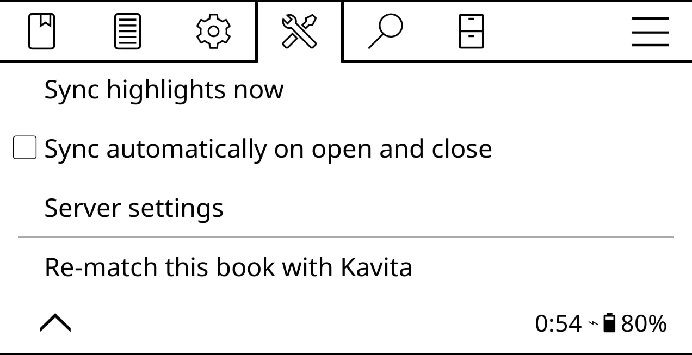

# Kavita highlight sync for KOReader

Two-way sync of EPUB **highlights and notes** between KOReader and Kavita.

- Highlights you make in KOReader show up in Kavita's web reader and annotation list.
- Highlights you make in Kavita's web reader appear in KOReader.
- Edits to a note or colour, and deletions, carry over in both directions.

There's nothing to install on the server. The plugin uses Kavita's existing REST API and the same API key as your Kavita progress sync.

## Install

1. Copy the `kavitahl.koplugin` folder into KOReader's `plugins/` folder (e.g. `koreader/plugins/` on Kobo, or `.adds/koreader/plugins/` on some setups).
2. Restart KOReader.

## Set up

If KOReader's **Progress sync** already points at Kavita (custom server `https://your-kavita/api/koreader/<key>`), there's nothing to set up: the plugin reads the server and key from there.

If it doesn't, open a book, then go to **Tools ▸ Kavita highlight sync ▸ Server settings** and enter:

- **Server URL**: `https://kavita.example.com`
- **API / auth key**: the same key Kavita's [KOReader setup guide](https://wiki.kavitareader.com/guides/3rdparty/koreader/) tells you to create.

## Use

Open a book, then go to **Tools ▸ Kavita highlight sync**.

- **Sync highlights now** syncs the open book.
- **Sync automatically on open and close** syncs when you open a book and pushes your local changes when you close it. It only runs if Wi-Fi is already on.
- **Re-match this book with Kavita** forgets the cached link and sync history for the open book. The next sync matches existing highlights by text, so nothing is duplicated.

## How it works

- **Finding the book.** Kavita already stores a hash of every file for KOReader progress sync. The plugin uses it to find the matching book, and remembers the match per book.
- **Two-way merge.** The plugin remembers the state of the last sync per book, so it can tell a highlight you deleted from one that is new on the other side. If a highlight was changed on both sides, the KOReader version wins.
- **No duplicates.** On a second device, or after *Re-match this book*, highlights with identical text are linked rather than duplicated.
- **Safety check.** If one sync would delete more than half of your synced highlights (and more than 3), or Kavita returns none of them for a book that has synced ones, it asks first. Automatic syncs hold those changes back until you run *Sync highlights now*.

### Colours

| Kavita slot (default colour) | KOReader colour        |
|------------------------------|------------------------|
| 0 cyan                       | cyan (also blue)       |
| 1 green                      | green (also olive)     |
| 2 yellow                     | yellow (also gray)     |
| 3 orange                     | orange (also red)      |
| 4 magenta                    | purple                 |

If you've changed your Kavita highlight slot colours, edit `COLOR_TO_SLOT` and `SLOT_TO_COLOR` in `kavitahl_mapping.lua`.

## Limitations

- The file on your device must be byte-identical to the one in Kavita, because Kavita matches books by file hash. Downloading it through Kavita's OPDS feed guarantees that; a converted or re-saved copy won't match.
- Only your own Kavita annotations sync. Spoiler flags and likes stay in Kavita; comments sync as plain text.
- A Kavita highlight whose text can't be found in the book (e.g. made in another edition) is reported as *couldn't be placed* and retried on every sync.

## Troubleshooting

If a sync reports failed changes, the message shows the first error (HTTP status plus Kavita's reply). The full details are in KOReader's `crash.log`, on lines starting with `KavitaHL:`.

## Development

CI runs these on LuaJIT, Lua 5.1 and Lua 5.4 for every push and pull request.

`tests/` holds tests that run outside KOReader with any Lua 5.1+ (`cd tests && lua test_mapping.lua`, or `texlua`):

- `test_mapping.lua`: xpointer/XPath conversion, colours, notes and the sync planner.
- `test_sync.lua`: whole sync runs against a fake KOReader document and a fake Kavita server.
- `test_api.lua`: HTTP handling (redirects on POST/DELETE, error messages).
